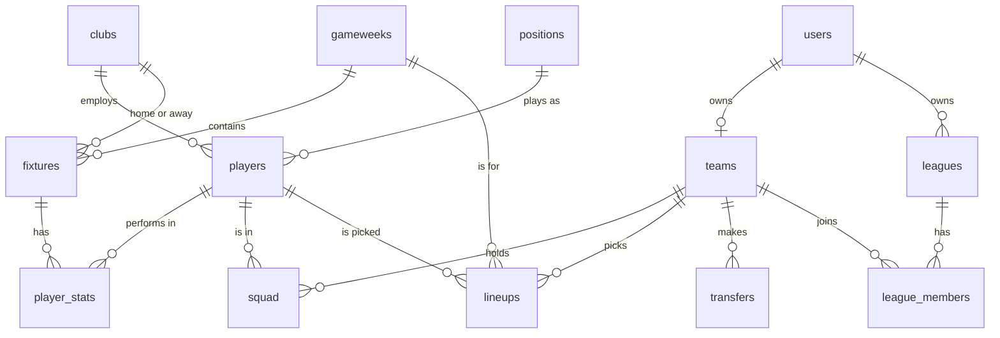

# FPL database

A PostgreSQL database for a Fantasy Premier League game: the data model, the
rules the database enforces, and views that compute points and tables. It is a
database, not a simulator. There is no clock, no deadlines and no gameweek
processing, you insert squads, lineups and results and the database keeps them
consistent and answers questions about them.

## Run

```bash
createdb fpl
psql -d fpl -f main.sql        # schema, rules, views and sample data, under a second
psql -d fpl -f queries.sql     # example queries
```

`main.sql` can be run again at any time, it drops and recreates everything.

## Files

| file | contents |
|---|---|
| `schema.sql` | 13 tables with keys, constraints and indexes |
| `rules.sql` | two triggers and one procedure: squad limits, lineup picks, transfers |
| `views.sql` | points, standings, mini-league tables, squad overview, lineup check |
| `sample_data.sql` | 20 clubs, 300 players, 100 fixtures, 12 teams with squads, lineups and transfers |
| `queries.sql` | 8 example queries |
| `main.sql` | runs the four files above in order |

## Model



**Football:** `positions`, `clubs`, `players`, `gameweeks`, `fixtures`, `player_stats`.
`positions` also holds squad limits, starter limits and the points for a goal and a clean sheet.

**Game:** `users`, `teams`, `squad`, `lineups`, `transfers`, `leagues`, `league_members`.
`squad` is the current squad, `lineups` is who counted in each gameweek, so selling a
player never changes past points.

## Rules

Enforced by constraints and triggers, a wrong move fails with a message saying why.

- squad: at most 15 players, 2 GKP, 5 DEF, 5 MID, 3 FWD, 3 per club, budget 100.0
- lineup: players come from the squad, at most 11 starters, position maximums, one captain, one vice, bench slots 1 to 4
- transfer: `CALL make_transfer(team, player_out, player_in, gameweek)` swaps the squad and the lineup and logs it, one transaction
- data: a fixture needs two different clubs, a player without minutes has no goals, scores come in pairs

Limits are upper bounds, so a squad is built one player at a time. Completeness is
reported by the `lineup_status` view instead of being forced.

## Views

| view | answers |
|---|---|
| `player_gameweek_points` | points of a player in a gameweek, double gameweeks added up |
| `team_gameweek_points` | team points, captain doubled, vice takes over when the captain did not play |
| `standings` | table of all teams with rank |
| `league_table` | table of each mini-league |
| `squad_overview` | squad with club, position, price and budget left |
| `lineup_status` | starters, bench, captain, vice, formation and whether the lineup is complete |

Points are never stored, they are computed from `player_stats` and `positions`.

## Left out on purpose

Deadlines, free transfers and penalties, chips, automatic substitutions, price changes,
several seasons. Deadlines are stored in `gameweeks` but not enforced.
